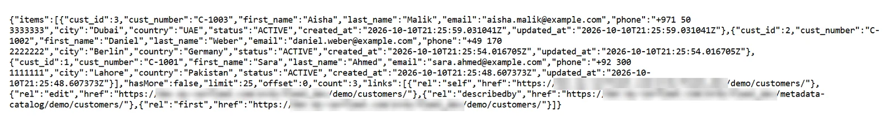
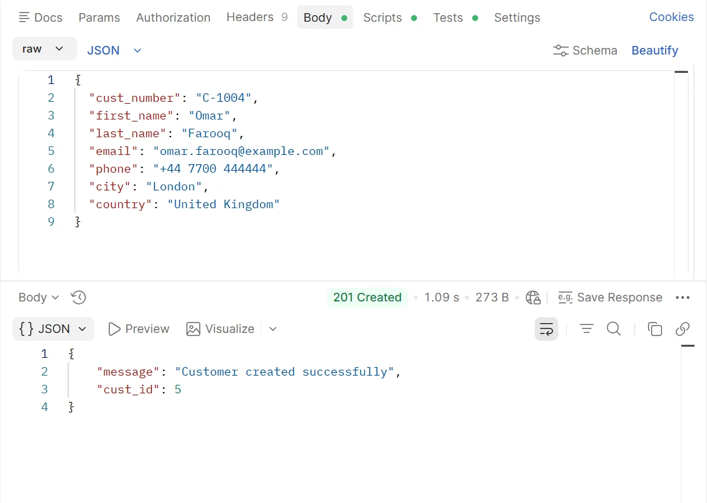
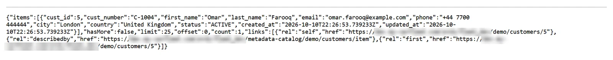
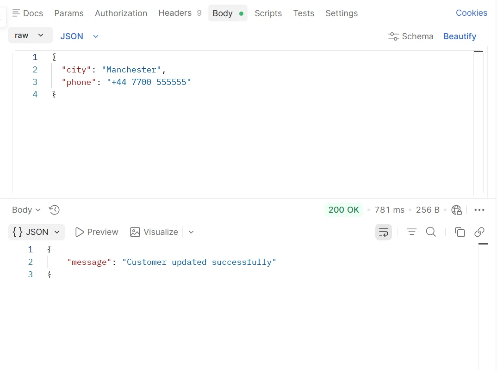
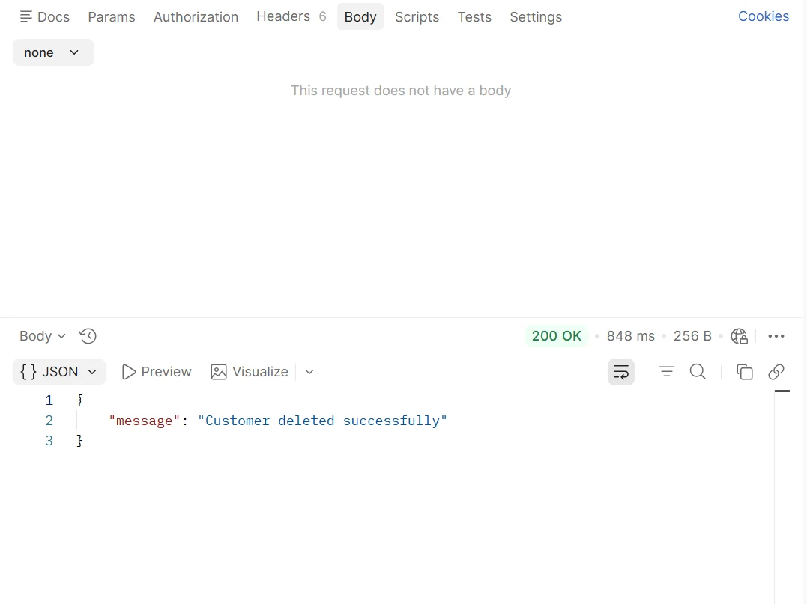

# Oracle REST Data Services (ORDS) Explained — Build a Complete CRUD REST API with GET, POST, PUT & DELETE

[](LICENSE)


> What ORDS is and how its modules, templates and handlers fit together, then a complete CRUD REST API on a customers table with GET, POST, PUT and DELETE, tested end to end and secured with OAuth.

<p align="center">
  
</p>

**By Hassaan Ahmed Tahir — Senior Oracle APEX Developer · [Read the full tutorial](https://apexwithhassaan.vercel.app/blog/ords-crud-rest-api)**

---

## 📁 Repository structure

```
apex-ords-crud-rest-api/
src/01_create_table.sql                # DEMO_CUSTOMERS table and sample rows
src/02_enable_schema.sql               # enable your schema for REST
src/03_create_api_one_script.sql       # fast track: module, templates and all 5 handlers in one script
src/04_oauth_client.sql                # secure the API with an OAuth client
src/handlers/01_get_customers.sql      # GET  /customers/       — list and filter
src/handlers/02_post_customer.sql      # POST /customers/       — create
src/handlers/03_get_customer.sql       # GET  /customers/:id    — read one
src/handlers/04_put_customer.sql       # PUT  /customers/:id    — update
src/handlers/05_delete_customer.sql    # DELETE /customers/:id  — remove
docs/images/                           # screenshots from the blog post
CHANGELOG.md
LICENSE                                # MIT
README.md
```

> 💡 Every file above contains the exact code from the tutorial below, ready to copy or run.

---

Every modern application eventually needs to talk to the database from *outside* Oracle APEX — a Next.js or React frontend, a mobile app, a partner system, an automation script. The cleanest way to open your Oracle data to all of them is a **REST API**, and Oracle already gives you one for free: **Oracle REST Data Services (ORDS)**.

In this post I'll explain what ORDS is, why it matters, and then build a **complete, working CRUD API** on a demo `CUSTOMERS` table — one handler for each HTTP method — with the exact SQL, the exact settings, a ready-to-run test command and the JSON you should get back. Everything is self-contained, so you can copy it and run it in **your own schema** in about 15 minutes.

> ✅ **What you'll have at the end:** five REST endpoints — list, read, create, update and delete customers — returning clean JSON with proper HTTP status codes (`200`, `201`, `400`, `404`, `409`), plus the steps to lock them down with OAuth.

> 🧪 **Tested end to end:** every handler in this post was run against a real ORDS server — in Postman and straight in the browser. The figure under each handler is the actual result.

## 📑 Table of Contents

1. [What Is ORDS and Why Does It Matter?](#what-is-ords)
2. [The Building Blocks: Module, Template, Handler, Parameter](#building-blocks)
3. [HTTP Methods and Their SQL Equivalents](#methods)
4. [AutoREST vs Custom Handlers — Which One Should You Use?](#autorest)
5. [Step 1: Create the Demo Table](#step-1)
6. [Step 2: Enable Your Schema for REST](#step-2)
7. [Step 3: Create the Module and Templates](#step-3)
8. [Handler 1 — GET: List (and Filter) Customers](#get-all)
9. [Handler 2 — POST: Create a Customer](#post)
10. [Handler 3 — GET: Read One Customer](#get-one)
11. [Handler 4 — PUT: Update a Customer](#put)
12. [Handler 5 — DELETE: Remove a Customer](#delete)
13. [Fast Track: Create Everything with One Script](#script)
14. [Transactions, Errors and Debugging](#transactions)
15. [HTTP Status Codes Cheat Sheet](#status-codes)
16. [Common Mistakes (and How to Avoid Them)](#gotchas)
17. [Securing Your API with OAuth](#security)
18. [Production Checklist](#best-practices)
19. [Wrap-Up and What's Next](#wrap-up)

<a id="what-is-ords"></a>

## 1. What Is ORDS and Why Does It Matter?

**Oracle REST Data Services (ORDS)** is a Java mid-tier application that sits between HTTP clients and your Oracle Database. It receives a normal web request such as `GET /customers/42`, runs the SQL or PL/SQL you mapped to that URL, and returns the result as **JSON**. If you use Oracle APEX, you already have ORDS — it's the same component that serves your APEX pages, so there is nothing extra to install.

Here's the full journey of a single request:

1. 💻 **Client** — Next.js, mobile app, Postman, curl
2. 🌐 **ORDS** — Matches URL + method to a handler, checks security
3. 🗄️ **Oracle DB** — Runs your SQL or PL/SQL in one transaction
4. 📦 **JSON Response** — Sent back with an HTTP status code

**Why it matters:**

- **No extra backend to build or host** — no Node.js or Java API layer in front of your database. Your SQL *is* the API.
- **Your business logic stays in the database** — handlers can call the same PL/SQL packages your APEX app already uses, so both apps follow the same rules.
- **Any client can connect** — REST and JSON are universal, so web, mobile and third-party systems all speak the same language.
- **Production-ready features built in** — automatic JSON, pagination, transaction handling, connection pooling, CORS control and OAuth2 security.
- **Fast to build** — a full CRUD API takes minutes, as you're about to see.

<a id="building-blocks"></a>

## 2. The Building Blocks: Module, Template, Handler, Parameter

Every ORDS API is made of four nested pieces. Once these click, everything else is easy:

| Piece | What it is | In our example |
|---|---|---|
| **Module** | A container that groups related endpoints and owns a **base path**. Security and CORS are usually set here. | `demo.customers` → `/demo/` |
| **Resource Template** | A URL pattern inside the module. Can contain variables like `:id`. | `customers/` and `customers/:id` |
| **Resource Handler** | The code that runs for **one HTTP method** on a template. | GET, POST, PUT, DELETE |
| **Parameter** | Maps a value into or out of the handler — URL values, HTTP headers, or response fields. | `cust_id`, `message` |

And this is how they combine into a final URL:

`https://your-server.com` · `/ords` · `/your_schema` · `/demo/` · `customers/` · `42`

- `/ords` — the ORDS context root
- `/your_schema` — your REST-enabled schema alias
- `/demo/` — the module's base path
- `customers/` — the resource template
- `42` — the value bound to `:id`

Inside a handler, values reach your code as **bind variables** from four places:

| Source | Example request | Available in the handler as |
|---|---|---|
| URI template variable | `/customers/42` | `:id` |
| Query string | `/customers/?city=Berlin` | `:city` |
| JSON request body | `{"first_name":"Omar"}` | `:first_name` |
| HTTP header (defined as a parameter) | `X-Request-Source: mobile` | Any bind name you choose |

<a id="methods"></a>

## 3. HTTP Methods and Their SQL Equivalents

REST uses the **same URL** for different actions — the HTTP method decides what happens. If you know SQL, you already know REST:

| Method | Template | SQL equivalent | Purpose |
|---|---|---|---|
| **GET** | `customers/` | `SELECT` (many rows) | List all customers |
| **POST** | `customers/` | `INSERT` | Create a new customer |
| **GET** | `customers/:id` | `SELECT` (one row) | Read one customer |
| **PUT** | `customers/:id` | `UPDATE` | Update one customer |
| **DELETE** | `customers/:id` | `DELETE` / soft delete | Remove one customer |

> 💡 **Rule of thumb:** methods that work on the whole collection (list, create) live on `customers/`. Methods that work on one specific record (read, update, delete) live on `customers/:id`.

<a id="autorest"></a>

## 4. AutoREST vs Custom Handlers — Which One Should You Use?

Before we build handlers by hand, you should know ORDS has a shortcut called **AutoREST**. One call REST-enables a whole table and instantly gives you GET, POST, PUT and DELETE:

```sql
BEGIN
  ORDS.ENABLE_OBJECT(
    p_enabled        => TRUE,
    p_schema         => USER,
    p_object         => 'DEMO_CUSTOMERS',
    p_object_type    => 'TABLE',
    p_object_alias   => 'demo_customers',
    p_auto_rest_auth => TRUE);   -- TRUE = callers need authorization
  COMMIT;
END;
/
```

So why build custom handlers at all? Because real applications need control:

|  | AutoREST | Custom handlers (this post) |
|---|---|---|
| Setup time | Seconds | Minutes |
| Columns exposed | Every column of the table | Only the columns you `SELECT` |
| Validation & business rules | Database constraints only | Any PL/SQL logic you want |
| Soft delete, audit columns | No — `DELETE` removes the row | Yes — you decide what DELETE means |
| Joins, calculated fields | No (one table or view) | Yes — any SQL |
| Error messages | Generic | Your own, with proper status codes |
| Best for | Prototypes, internal tools | Production APIs and real frontends |

The rest of this post builds the custom-handler version, because that's what you'll use in real projects.

<a id="step-1"></a>

## 5. Step 1: Create the Demo Table

Run this in **SQL Workshop → SQL Commands** (or SQL Developer). It creates a small customers table with sensible constraints, plus three sample rows so the GET endpoints return data straight away:

```sql
CREATE TABLE demo_customers (
  cust_id      NUMBER GENERATED BY DEFAULT ON NULL AS IDENTITY PRIMARY KEY,
  cust_number  VARCHAR2(30)  NOT NULL,
  first_name   VARCHAR2(100) NOT NULL,
  last_name    VARCHAR2(100),
  email        VARCHAR2(200),
  phone        VARCHAR2(50),
  city         VARCHAR2(100),
  country      VARCHAR2(100),
  status       VARCHAR2(10)  DEFAULT 'ACTIVE' NOT NULL,
  deleted_yn   VARCHAR2(3)   DEFAULT 'NO'     NOT NULL,
  created_at   TIMESTAMP     DEFAULT SYSTIMESTAMP NOT NULL,
  updated_at   TIMESTAMP     DEFAULT SYSTIMESTAMP NOT NULL,
  CONSTRAINT demo_cust_number_uk  UNIQUE (cust_number),
  CONSTRAINT demo_cust_email_uk   UNIQUE (email),
  CONSTRAINT demo_cust_status_ck  CHECK (status IN ('ACTIVE', 'INACTIVE')),
  CONSTRAINT demo_cust_deleted_ck CHECK (deleted_yn IN ('YES', 'NO'))
);
```

```sql
INSERT INTO demo_customers (cust_number, first_name, last_name, email, phone, city, country)
VALUES ('C-1001', 'Sara', 'Ahmed', 'sara.ahmed@example.com', '+92 300 1111111', 'Lahore', 'Pakistan');

INSERT INTO demo_customers (cust_number, first_name, last_name, email, phone, city, country)
VALUES ('C-1002', 'Daniel', 'Weber', 'daniel.weber@example.com', '+49 170 2222222', 'Berlin', 'Germany');

INSERT INTO demo_customers (cust_number, first_name, last_name, email, phone, city, country)
VALUES ('C-1003', 'Aisha', 'Malik', 'aisha.malik@example.com', '+971 50 3333333', 'Dubai', 'UAE');

COMMIT;
```

The two `UNIQUE` constraints and the `CHECK` constraint aren't just decoration — our handlers will turn violations of them into clean `409` and `400` responses instead of raw Oracle errors. The identity column requires Oracle Database 12c or later.

<a id="step-2"></a>

## 6. Step 2: Enable Your Schema for REST

ORDS only serves schemas that are explicitly REST-enabled. In APEX, open **SQL Workshop → RESTful Services**. If you see a *Register Schema with ORDS* button, click it and accept the defaults. If the page opens straight to Modules, your schema is already enabled and you can skip this step.

Prefer SQL? This does the same thing:

```sql
BEGIN
  ORDS.ENABLE_SCHEMA(
    p_enabled             => TRUE,
    p_schema              => USER,
    p_url_mapping_type    => 'BASE_PATH',
    p_url_mapping_pattern => LOWER(USER),
    p_auto_rest_auth      => TRUE);
  COMMIT;
END;
/
```

The `p_url_mapping_pattern` value is the `your_schema` part of every URL in this post. `p_auto_rest_auth => TRUE` protects the schema's metadata catalog — it does **not** affect the custom handlers we build below; we'll secure those ourselves in the OAuth section.

<a id="step-3"></a>

## 7. Step 3: Create the Module and Templates

In **SQL Workshop → RESTful Services → Modules**, click **Create Module**:

| Setting | Value |
|---|---|
| Module Name | `demo.customers` |
| Base Path | `/demo/` |
| Is Published | Yes |
| Pagination Size | `25` |
| Origins Allowed | Leave empty for now (see the Production Checklist) |

Then, inside the module, click **Create Template** twice:

| URI Template | Used for |
|---|---|
| `customers/` | The whole collection — list (GET) and create (POST) |
| `customers/:id` | A single customer — read (GET), update (PUT), delete (DELETE) |

Now we add the five handlers. For each one you get the settings, the source code, a test command and the response you should see.

> 🔗 In all test commands, replace `https://your-server.com/ords/your_schema/demo/customers/` with your own server and schema alias. The `-i` flag makes `curl` print the HTTP status line and headers, so you can see the status code.

<a id="get-all"></a>

## 8. Handler 1 — GET: List (and Filter) Customers

**GET** `/demo/customers/` — Source type: Collection Query · No parameters needed

On the `customers/` template click **Create Handler**, choose Method **GET** and Source Type **Collection Query**, and paste:

```sql
SELECT cust_id,
       cust_number,
       first_name,
       last_name,
       email,
       phone,
       city,
       country,
       status,
       created_at,
       updated_at
FROM   demo_customers
WHERE  deleted_yn = 'NO'
AND    (:city IS NULL OR UPPER(city) = UPPER(:city))
ORDER BY cust_id DESC
```

**Collection Query** is the easiest source type: you write a plain `SELECT`, and ORDS converts every row to JSON and adds pagination for you.

- `deleted_yn = 'NO'` hides soft-deleted customers (more on that in Handler 5).
- `:city` is an **optional filter**. ORDS binds query-string values automatically, so `?city=Berlin` fills `:city` — and when it's missing, the bind is `NULL` and the condition is simply ignored. No parameter definition needed.

```bash
curl -i https://your-server.com/ords/your_schema/demo/customers/
```

```json
{
  "items": [
    {
      "cust_id": 3,
      "cust_number": "C-1003",
      "first_name": "Aisha",
      "last_name": "Malik",
      "email": "aisha.malik@example.com",
      "phone": "+971 50 3333333",
      "city": "Dubai",
      "country": "UAE",
      "status": "ACTIVE",
      "created_at": "2026-10-10T21:25:59.031041Z",
      "updated_at": "2026-10-10T21:25:59.031041Z"
    }
  ],
  "hasMore": false,
  "limit": 25,
  "offset": 0,
  "count": 3,
  "links": [
    { "rel": "self",        "href": "https://your-server.com/ords/your_schema/demo/customers/" },
    { "rel": "edit",        "href": "https://your-server.com/ords/your_schema/demo/customers/" },
    { "rel": "describedby", "href": "https://your-server.com/ords/your_schema/metadata-catalog/demo/customers/" },
    { "rel": "first",       "href": "https://your-server.com/ords/your_schema/demo/customers/" }
  ]
}
```

```bash
curl -i "https://your-server.com/ords/your_schema/demo/customers/?city=Berlin"
```

This returns only Daniel Weber. Notice that ORDS returns `TIMESTAMP` values in ISO-8601 UTC format (the trailing `Z`) — your frontend can pass them straight to `new Date()`.

> 💡 **Pagination is free:** `?offset=25` returns the next page and `?limit=10` changes the page size (up to the module's pagination size). `hasMore` tells your frontend whether another page exists, and a `next` link appears in `links` when it does.

<p align="center">
  <br>
  <em>Figure 1 · GET /demo/customers/ — list all customers. The list endpoint opened directly in the browser — the three sample customers come back as JSON with items, hasMore, count and the links array ORDS adds automatically.</em>
</p>

<a id="post"></a>

## 9. Handler 2 — POST: Create a Customer

**POST** `/demo/customers/` — Source type: PL/SQL · Two OUT parameters

On the same `customers/` template, create a second handler with Method **POST** and Source Type **PL/SQL**:

```sql
DECLARE
  e_check_violation EXCEPTION;
  PRAGMA EXCEPTION_INIT(e_check_violation, -2290);
  v_cust_id demo_customers.cust_id%TYPE;
BEGIN
  -- 1. Validate required fields
  IF :cust_number IS NULL OR :first_name IS NULL THEN
    :status_code := 400;
    :message     := 'cust_number and first_name are required';
    RETURN;
  END IF;

  -- 2. Insert the row (JSON body fields arrive as bind variables)
  INSERT INTO demo_customers
         (cust_number, first_name, last_name, email, phone, city, country, status)
  VALUES (:cust_number, :first_name, :last_name, LOWER(:email),
          :phone, :city, :country, NVL(UPPER(:status), 'ACTIVE'))
  RETURNING cust_id INTO v_cust_id;

  -- 3. Build the response
  :status_code := 201;
  :cust_id     := v_cust_id;
  :message     := 'Customer created successfully';
EXCEPTION
  WHEN DUP_VAL_ON_INDEX THEN
    :status_code := 409;
    :message     := 'Customer number or email already exists';
  WHEN e_check_violation THEN
    :status_code := 400;
    :message     := 'status must be ACTIVE or INACTIVE';
END;
```

Then add these two parameters in the handler's **Parameters** section:

| Name | Bind Variable | Access Method | Source Type | Data Type |
|---|---|---|---|---|
| cust_id | cust_id | OUT | Response | INT |
| message | message | OUT | Response | STRING |

Three pieces of ORDS behaviour make this handler short:

- **Automatic JSON binding:** when the request body is JSON (`Content-Type: application/json`), ORDS turns every top-level key into a bind variable with the same name. The JSON key `"first_name"` becomes `:first_name` — you do *not* create parameters for these. A key that isn't sent is simply `NULL`.
- **`:status_code`** is a built-in ORDS bind variable. Whatever number you assign becomes the HTTP status of the response. `201 Created` is the correct code for a successful POST.
- **OUT parameters with Source Type *Response*** become the keys of the JSON response — that's where `cust_id` and `message` come from.

```bash
curl -i -X POST https://your-server.com/ords/your_schema/demo/customers/ \
  -H "Content-Type: application/json" \
  -d '{"cust_number":"C-1004","first_name":"Omar","last_name":"Farooq","email":"omar.farooq@example.com","phone":"+44 7700 444444","city":"London","country":"United Kingdom"}'
```

```json
{
  "message": "Customer created successfully",
  "cust_id": 4
}
```

```json
{
  "message": "Customer number or email already exists"
}
```

```json
{
  "message": "cust_number and first_name are required"
}
```

The exact `cust_id` you get depends on your table — identity values can skip numbers (for example after a failed insert), which is completely normal. In my test run it came back as `5`, which is why the screenshots below use `/customers/5`. Use whatever ID comes back in the next steps.

> 💡 **Pro tip — the `Location` header:** REST convention says a `201` should also tell the client where the new resource lives. Add one more OUT parameter with Name `Location`, Bind Variable `location`, Source Type **Header**, Data Type STRING, and assign it in the handler: `:location := 'customers/' || v_cust_id;`. HTTP allows a relative URL here, so the client can follow it straight to the new record.

<p align="center">
  <br>
  <em>Figure 2 · POST /demo/customers/ — create a customer. Creating Omar Farooq in Postman (Body → raw → JSON). ORDS answers 201 Created with the new cust_id and our success message.</em>
</p>

<a id="get-one"></a>

## 10. Handler 3 — GET: Read One Customer

**GET** `/demo/customers/:id` — Source type: Collection Query Item · No parameters needed

Now switch to the `customers/:id` template. Create a handler with Method **GET** and Source Type **Collection Query Item**:

```sql
SELECT cust_id,
       cust_number,
       first_name,
       last_name,
       email,
       phone,
       city,
       country,
       status,
       created_at,
       updated_at
FROM   demo_customers
WHERE  cust_id    = :id
AND    deleted_yn = 'NO'
```

The `:id` bind comes straight from the URL — `/customers/4` binds `4`. **Collection Query Item** returns a single JSON object instead of an `items` array, and if the query finds no row, ORDS automatically responds with `404 Not Found`. No extra code needed.

```bash
curl -i https://your-server.com/ords/your_schema/demo/customers/4
```

```json
{
  "cust_id": 4,
  "cust_number": "C-1004",
  "first_name": "Omar",
  "last_name": "Farooq",
  "email": "omar.farooq@example.com",
  "phone": "+44 7700 444444",
  "city": "London",
  "country": "United Kingdom",
  "status": "ACTIVE",
  "created_at": "2026-10-10T22:26:53.739233Z",
  "updated_at": "2026-10-10T22:26:53.739233Z"
}
```

```bash
curl -i https://your-server.com/ords/your_schema/demo/customers/999
```

You'll get `404 Not Found` automatically.

<p align="center">
  <br>
  <em>Figure 3 · GET /demo/customers/5 — read one customer. Reading the new customer back by ID — every field we sent in the POST is stored correctly.</em>
</p>

<a id="put"></a>

## 11. Handler 4 — PUT: Update a Customer

**PUT** `/demo/customers/:id` — Source type: PL/SQL · One OUT parameter

On `customers/:id`, create a handler with Method **PUT** and Source Type **PL/SQL**:

```sql
DECLARE
  e_check_violation EXCEPTION;
  PRAGMA EXCEPTION_INIT(e_check_violation, -2290);
BEGIN
  UPDATE demo_customers
     SET first_name = COALESCE(:first_name, first_name)
       , last_name  = COALESCE(:last_name,  last_name)
       , email      = COALESCE(LOWER(:email), email)
       , phone      = COALESCE(:phone,      phone)
       , city       = COALESCE(:city,       city)
       , country    = COALESCE(:country,    country)
       , status     = COALESCE(UPPER(:status), status)
       , updated_at = SYSTIMESTAMP
   WHERE cust_id    = :id
     AND deleted_yn = 'NO';

  IF SQL%ROWCOUNT = 0 THEN
    :status_code := 404;
    :message     := 'Customer not found';
  ELSE
    :status_code := 200;
    :message     := 'Customer updated successfully';
  END IF;
EXCEPTION
  WHEN DUP_VAL_ON_INDEX THEN
    :status_code := 409;
    :message     := 'Email already belongs to another customer';
  WHEN e_check_violation THEN
    :status_code := 400;
    :message     := 'status must be ACTIVE or INACTIVE';
END;
```

| Name | Bind Variable | Access Method | Source Type | Data Type |
|---|---|---|---|---|
| message | message | OUT | Response | STRING |

The key technique here is `COALESCE(:field, column)`: if a key is **missing** from the JSON body, its bind is `NULL` and the column keeps its current value. That means a client can send only the fields it wants to change. `SQL%ROWCOUNT = 0` tells us no row matched, so we answer with `404`. `cust_number` is deliberately not updatable — business keys should never change.

```bash
curl -i -X PUT https://your-server.com/ords/your_schema/demo/customers/4 \
  -H "Content-Type: application/json" \
  -d '{"city":"Manchester","phone":"+44 7700 555555"}'
```

```json
{
  "message": "Customer updated successfully"
}
```

```json
{
  "message": "status must be ACTIVE or INACTIVE"
}
```

Run the Handler 3 GET again and you'll see Manchester and a newer `updated_at`.

> 💡 **PUT vs PATCH:** strictly speaking, REST uses `PUT` to *replace* a whole resource and `PATCH` for partial changes. Many real-world APIs use `PUT` for partial updates exactly like this because it's simpler for clients — just be consistent and document it. One trade-off: with `COALESCE`, a client can't deliberately clear a field by sending `null`. If you need that, accept an explicit flag or write a full-replacement update.

<p align="center">
  <br>
  <em>Figure 4 · PUT /demo/customers/5 — update a customer. A partial update: only city and phone are sent, every other column keeps its value. ORDS answers 200 OK.</em>
</p>

<a id="delete"></a>

## 12. Handler 5 — DELETE: Remove a Customer

**DELETE** `/demo/customers/:id` — Source type: PL/SQL · One OUT parameter

Last one. On `customers/:id`, create a handler with Method **DELETE** and Source Type **PL/SQL**:

```sql
BEGIN
  UPDATE demo_customers
     SET deleted_yn = 'YES'
       , status     = 'INACTIVE'
       , updated_at = SYSTIMESTAMP
   WHERE cust_id    = :id
     AND deleted_yn = 'NO';

  IF SQL%ROWCOUNT = 0 THEN
    :status_code := 404;
    :message     := 'Customer not found or already deleted';
  ELSE
    :status_code := 200;
    :message     := 'Customer deleted successfully';
  END IF;
END;
```

| Name | Bind Variable | Access Method | Source Type | Data Type |
|---|---|---|---|---|
| message | message | OUT | Response | STRING |

This is a **soft delete**: the row stays in the table with `deleted_yn = 'YES'`, and both GET handlers stop returning it. That's how most real business applications work — you keep the history, foreign keys stay valid, and you can restore a record later. If you really want to remove the row, replace the `UPDATE` with `DELETE FROM demo_customers WHERE cust_id = :id;` and the rest of the handler stays the same.

```bash
curl -i -X DELETE https://your-server.com/ords/your_schema/demo/customers/4
```

```json
{
  "message": "Customer deleted successfully"
}
```

```bash
curl -i https://your-server.com/ords/your_schema/demo/customers/4
```

```text
(no response body)
```

```json
{
  "message": "Customer not found or already deleted"
}
```

> 💡 **Soft delete and unique keys:** a soft-deleted row still holds its `cust_number` and `email`, so creating a new customer with the same values returns `409`. That's usually what you want. If not, build the unique constraints on `(email, deleted_yn)` or use a function-based unique index on active rows only.

> ✅ **That's a complete CRUD API** — five handlers, two templates, one module, and zero lines of backend code outside the database.

<p align="center">
  <br>
  <em>Figure 5 · DELETE /demo/customers/5 — remove a customer. No request body needed. The soft delete flags the row, and the customer disappears from both GET endpoints.</em>
</p>

> ✅ **All five handlers verified** — list, create, read, update and delete all returned the expected status codes and JSON.

<a id="script"></a>

## 13. Fast Track: Create Everything with One Script

Clicking through the UI is the best way to *learn* ORDS. But once you understand it, scripts are faster, repeatable, and easy to keep in Git. This single block creates the module, both templates, all five handlers and their parameters — exactly the same API you just built by hand:

```sql
BEGIN
  -- Module: the container, owns the base path /demo/
  ORDS.DEFINE_MODULE(
    p_module_name    => 'demo.customers',
    p_base_path      => '/demo/',
    p_items_per_page => 25,
    p_status         => 'PUBLISHED',
    p_comments       => 'Demo CRUD API for DEMO_CUSTOMERS');

  -- Templates: the two URL shapes
  ORDS.DEFINE_TEMPLATE(p_module_name => 'demo.customers', p_pattern => 'customers/');
  ORDS.DEFINE_TEMPLATE(p_module_name => 'demo.customers', p_pattern => 'customers/:id');

  -- customers/  ->  GET (list) + POST (create)
  ORDS.DEFINE_HANDLER(
    p_module_name    => 'demo.customers',
    p_pattern        => 'customers/',
    p_method         => 'GET',
    p_source_type    => ORDS.source_type_collection_feed,
    p_items_per_page => 25,
    p_source         => q'[
      SELECT cust_id,
             cust_number,
             first_name,
             last_name,
             email,
             phone,
             city,
             country,
             status,
             created_at,
             updated_at
      FROM   demo_customers
      WHERE  deleted_yn = 'NO'
      AND    (:city IS NULL OR UPPER(city) = UPPER(:city))
      ORDER BY cust_id DESC
    ]');

  ORDS.DEFINE_HANDLER(
    p_module_name    => 'demo.customers',
    p_pattern        => 'customers/',
    p_method         => 'POST',
    p_source_type    => ORDS.source_type_plsql,
    p_source         => q'[
      DECLARE
        e_check_violation EXCEPTION;
        PRAGMA EXCEPTION_INIT(e_check_violation, -2290);
        v_cust_id demo_customers.cust_id%TYPE;
      BEGIN
        -- 1. Validate required fields
        IF :cust_number IS NULL OR :first_name IS NULL THEN
          :status_code := 400;
          :message     := 'cust_number and first_name are required';
          RETURN;
        END IF;

        -- 2. Insert the row (JSON body fields arrive as bind variables)
        INSERT INTO demo_customers
               (cust_number, first_name, last_name, email, phone, city, country, status)
        VALUES (:cust_number, :first_name, :last_name, LOWER(:email),
                :phone, :city, :country, NVL(UPPER(:status), 'ACTIVE'))
        RETURNING cust_id INTO v_cust_id;

        -- 3. Build the response
        :status_code := 201;
        :cust_id     := v_cust_id;
        :message     := 'Customer created successfully';
      EXCEPTION
        WHEN DUP_VAL_ON_INDEX THEN
          :status_code := 409;
          :message     := 'Customer number or email already exists';
        WHEN e_check_violation THEN
          :status_code := 400;
          :message     := 'status must be ACTIVE or INACTIVE';
      END;
    ]');

  ORDS.DEFINE_PARAMETER(
    p_module_name        => 'demo.customers',
    p_pattern            => 'customers/',
    p_method             => 'POST',
    p_name               => 'cust_id',
    p_bind_variable_name => 'cust_id',
    p_source_type        => 'RESPONSE',
    p_param_type         => 'INT',
    p_access_method      => 'OUT');

  ORDS.DEFINE_PARAMETER(
    p_module_name        => 'demo.customers',
    p_pattern            => 'customers/',
    p_method             => 'POST',
    p_name               => 'message',
    p_bind_variable_name => 'message',
    p_source_type        => 'RESPONSE',
    p_param_type         => 'STRING',
    p_access_method      => 'OUT');

  -- customers/:id  ->  GET (one) + PUT (update) + DELETE (soft delete)
  ORDS.DEFINE_HANDLER(
    p_module_name    => 'demo.customers',
    p_pattern        => 'customers/:id',
    p_method         => 'GET',
    p_source_type    => ORDS.source_type_collection_item,
    p_source         => q'[
      SELECT cust_id,
             cust_number,
             first_name,
             last_name,
             email,
             phone,
             city,
             country,
             status,
             created_at,
             updated_at
      FROM   demo_customers
      WHERE  cust_id    = :id
      AND    deleted_yn = 'NO'
    ]');

  ORDS.DEFINE_HANDLER(
    p_module_name    => 'demo.customers',
    p_pattern        => 'customers/:id',
    p_method         => 'PUT',
    p_source_type    => ORDS.source_type_plsql,
    p_source         => q'[
      DECLARE
        e_check_violation EXCEPTION;
        PRAGMA EXCEPTION_INIT(e_check_violation, -2290);
      BEGIN
        UPDATE demo_customers
           SET first_name = COALESCE(:first_name, first_name)
             , last_name  = COALESCE(:last_name,  last_name)
             , email      = COALESCE(LOWER(:email), email)
             , phone      = COALESCE(:phone,      phone)
             , city       = COALESCE(:city,       city)
             , country    = COALESCE(:country,    country)
             , status     = COALESCE(UPPER(:status), status)
             , updated_at = SYSTIMESTAMP
         WHERE cust_id    = :id
           AND deleted_yn = 'NO';

        IF SQL%ROWCOUNT = 0 THEN
          :status_code := 404;
          :message     := 'Customer not found';
        ELSE
          :status_code := 200;
          :message     := 'Customer updated successfully';
        END IF;
      EXCEPTION
        WHEN DUP_VAL_ON_INDEX THEN
          :status_code := 409;
          :message     := 'Email already belongs to another customer';
        WHEN e_check_violation THEN
          :status_code := 400;
          :message     := 'status must be ACTIVE or INACTIVE';
      END;
    ]');

  ORDS.DEFINE_PARAMETER(
    p_module_name        => 'demo.customers',
    p_pattern            => 'customers/:id',
    p_method             => 'PUT',
    p_name               => 'message',
    p_bind_variable_name => 'message',
    p_source_type        => 'RESPONSE',
    p_param_type         => 'STRING',
    p_access_method      => 'OUT');

  ORDS.DEFINE_HANDLER(
    p_module_name    => 'demo.customers',
    p_pattern        => 'customers/:id',
    p_method         => 'DELETE',
    p_source_type    => ORDS.source_type_plsql,
    p_source         => q'[
      BEGIN
        UPDATE demo_customers
           SET deleted_yn = 'YES'
             , status     = 'INACTIVE'
             , updated_at = SYSTIMESTAMP
         WHERE cust_id    = :id
           AND deleted_yn = 'NO';

        IF SQL%ROWCOUNT = 0 THEN
          :status_code := 404;
          :message     := 'Customer not found or already deleted';
        ELSE
          :status_code := 200;
          :message     := 'Customer deleted successfully';
        END IF;
      END;
    ]');

  ORDS.DEFINE_PARAMETER(
    p_module_name        => 'demo.customers',
    p_pattern            => 'customers/:id',
    p_method             => 'DELETE',
    p_name               => 'message',
    p_bind_variable_name => 'message',
    p_source_type        => 'RESPONSE',
    p_param_type         => 'STRING',
    p_access_method      => 'OUT');

  COMMIT;
END;
/
```

> 💡 **Re-running is safe:** `ORDS.DEFINE_MODULE` replaces an existing module with the same name, together with its templates and handlers. To remove everything later: `BEGIN ORDS.DELETE_MODULE(p_module_name => 'demo.customers'); COMMIT; END;` and `DROP TABLE demo_customers PURGE;`. Already built the module in the UI? Open it in RESTful Services and click **Export** to get an equivalent script for source control.

<a id="transactions"></a>

## 14. Transactions, Errors and Debugging

Three things ORDS does behind the scenes that every developer should know:

- **Every request is one transaction.** If your handler finishes normally, ORDS **commits** automatically. If it raises an unhandled exception, ORDS **rolls back**. That's why none of our handlers contain `COMMIT` — and you shouldn't add one, because it would break that all-or-nothing behaviour.
- **Unhandled errors return `555 User Defined Resource Error`.** If you see a 555, your SQL or PL/SQL failed (a typo, a missing column, an unexpected ORA- error). Depending on your ORDS configuration, the response body shows the Oracle error or a generic page.
- **Caught errors are your responsibility.** When you catch an exception and set `:status_code` yourself, ORDS sees a normal finish and commits. With a single DML statement that's safe (the failed statement is already rolled back), but if a handler does several steps, roll back explicitly:

```sql
EXCEPTION
  WHEN OTHERS THEN
    ROLLBACK;                    -- undo any earlier steps in this request
    -- log SQLERRM to your own error-log table here
    :status_code := 500;
    :message     := 'Unexpected error, please contact support';
```

> 💡 **Debugging a 555:** copy the handler's PL/SQL into **SQL Commands**, replace the bind variables with literal values, and run it. The real ORA- error and line number appear immediately. Never return raw `SQLERRM` to clients in production — it leaks table and column names.

<a id="status-codes"></a>

## 15. HTTP Status Codes Cheat Sheet

A good API answers with the right status code, not just a message. Here's every code our API can return:

| Code | Meaning | Returned by |
|---|---|---|
| **200** OK | Request succeeded | GET, PUT, DELETE |
| **201** Created | A new record was created | POST |
| **400** Bad Request | Missing or invalid input | POST, PUT (validation) |
| **401** Unauthorized | No valid token (once secured) | Any endpoint |
| **404** Not Found | The record or the URL doesn't exist | GET one, PUT, DELETE, wrong URL |
| **405** Method Not Allowed | No handler for that method on the template | e.g. DELETE on `customers/` |
| **409** Conflict | Duplicate unique value | POST, PUT |
| **555** User Defined Resource Error | Unhandled error inside your handler code | Any — check your SQL/PL/SQL |

<a id="gotchas"></a>

## 16. Common Mistakes (and How to Avoid Them)

| Mistake | What happens | Fix |
|---|---|---|
| Forgetting the `Content-Type: application/json` header | Every body bind (`:first_name` etc.) arrives as `NULL` | Always send the header with POST and PUT |
| Reading `:body` or `:body_text` in the handler | Automatic JSON binding is switched off — all body binds are `NULL` | Use either automatic binding *or* parse `:body_text` yourself with `JSON_TABLE`/`APEX_JSON`, not both |
| Creating IN parameters for JSON body fields | Binding gets confused or values come through empty | Only define parameters for headers and OUT responses |
| Expecting uppercase JSON keys | Your frontend reads `CUST_ID` and gets `undefined` | ORDS returns column names in **lowercase** — use `cust_id`. Quoted aliases like `"custId"` keep their case |
| Adding `COMMIT` inside handlers | Partial work is saved even when a later step fails | Let ORDS commit — see Transactions section |
| Mixing up template slashes | `404` on a URL you're sure exists | `customers/` is called with the trailing slash; `customers/:id` without |
| Using Collection Query for single records | You get an `items` array with one element | Use **Collection Query Item** for `:id` templates |
| Selecting sensitive columns | Passwords, tokens or internal flags leak to every caller | Only `SELECT` the columns a client actually needs |
| Calling the API from browser JavaScript on another domain | CORS error in the browser console, even though curl works | Set **Origins Allowed** on the module (see Production Checklist) |

> 💡 **Testing on Windows?** The JSON quoting in the `curl` examples works in Git Bash, macOS and Linux. In plain Command Prompt the quotes get mangled — use Postman (Body → raw → JSON) or PowerShell instead:

```powershell
$body = @{ cust_number = "C-1005"; first_name = "Lina"; city = "Paris"; country = "France" } | ConvertTo-Json
Invoke-RestMethod -Uri "https://your-server.com/ords/your_schema/demo/customers/" -Method Post -Body $body -ContentType "application/json"
```

<a id="security"></a>

## 17. Securing Your API with OAuth

> ⚠️ **Important:** right now, anyone who knows the URL can list, create, change and delete your customers. That's fine for a quick demo in a dev schema, but **never leave a write-enabled API open** on a real system. The quickest temporary lock is to set the module's **Is Published** to **No**.

ORDS protects endpoints with **privileges**. A privilege maps a URL pattern to a role, and only callers holding that role get through. First, protect everything under `/demo/`:

```sql
DECLARE
  l_roles    OWA.VC_ARR;
  l_patterns OWA.VC_ARR;
BEGIN
  ORDS.CREATE_ROLE(p_role_name => 'demo_api_role');

  l_roles(1)    := 'demo_api_role';
  l_patterns(1) := '/demo/*';

  ORDS.DEFINE_PRIVILEGE(
    p_privilege_name => 'demo.api.privilege',
    p_roles          => l_roles,
    p_patterns       => l_patterns,
    p_label          => 'Demo Customers API',
    p_description    => 'Protects all /demo/ endpoints');
  COMMIT;
END;
/
```

From now on, every call returns `401 Unauthorized`. (In the APEX UI you can do the same under **RESTful Services → Privileges** and **Roles**.) Next, create an OAuth client — the "account" your frontend or partner system will use:

```sql
BEGIN
  OAUTH.CREATE_CLIENT(
    p_name            => 'demo_client',
    p_grant_type      => 'client_credentials',
    p_owner           => 'Demo Owner',
    p_description     => 'Client for the demo customers API',
    p_support_email   => 'support@example.com',
    p_privilege_names => 'demo.api.privilege');

  OAUTH.GRANT_CLIENT_ROLE(
    p_client_name => 'demo_client',
    p_role_name   => 'demo_api_role');
  COMMIT;
END;
/

SELECT client_id, client_secret
FROM   user_ords_clients
WHERE  name = 'demo_client';
```

```bash
# Exchange the client credentials for an access token
curl -i -u "CLIENT_ID:CLIENT_SECRET" \
  --data "grant_type=client_credentials" \
  https://your-server.com/ords/your_schema/oauth/token

# Call the API with the token
curl -i https://your-server.com/ords/your_schema/demo/customers/ \
  -H "Authorization: Bearer YOUR_ACCESS_TOKEN"
```

```json
{
  "access_token": "sCvAX6Hc-hb2Eud7-2QS8g",
  "token_type": "bearer",
  "expires_in": 3600
}
```

The token is valid for `expires_in` seconds (one hour by default). Your client simply requests a new one when it expires. Keep the client secret on the **server side** only — never ship it inside browser JavaScript.

> ℹ️ **Version note:** newer ORDS releases add the `ORDS_SECURITY` package as the modern way to manage OAuth clients, and may no longer show the secret in `user_ords_clients`. If the secret column comes back empty, generate it with `ORDS_SECURITY` (or the OAuth Clients page in SQL Developer Web). The `OAUTH` package shown here is still the most widely documented starting point.

<a id="best-practices"></a>

## 18. Production Checklist

Before you point a real application at your API, run through this list:

| ✔ | Practice | Why |
|---|---|---|
| 🔢 | **Version the base path** — `/demo/v1/` instead of `/demo/` | You can ship `v2` later without breaking existing clients |
| 🔒 | **Protect every write endpoint** with a privilege and OAuth | Open APIs get found — and abused — quickly |
| 🌍 | **Set Origins Allowed** on the module (e.g. `https://app.example.com`) | Required when browser JavaScript calls ORDS directly from another domain. Server-side calls (like a Next.js API route) don't need it |
| 📦 | **Move logic into PL/SQL packages** — the handler becomes a one-line call | APEX pages and the API share the same validated logic |
| 🙈 | **Expose only what clients need** — no internal flags, hashes or audit columns | Smaller payloads and no accidental data leaks |
| 🧾 | **Return safe error messages** and log the real error yourself | Raw ORA- messages reveal your schema |
| 🗂️ | **Keep module scripts in Git** (use Export or the one-shot script) | Repeatable deployments across DEV, TEST and PROD |
| 🔐 | **HTTPS only** | Tokens and customer data must never travel in plain text |

<a id="wrap-up"></a>

## 19. Wrap-Up and What's Next

In one post we went from zero to a complete, production-minded REST API on top of an Oracle table:

- **Module → Template → Handler → Parameter** — the four building blocks of every ORDS API, and when to use AutoREST instead.
- **Collection Query** and **Collection Query Item** for reads — plain SQL, automatic JSON, pagination, query-string filtering and 404s.
- **PL/SQL handlers** for writes — automatic JSON body binding, `:status_code` for proper HTTP responses, and constraint errors turned into clean `400`/`409` messages.
- **Soft delete**, partial updates with `COALESCE`, transaction behaviour, a one-shot deployment script, **OAuth** security and a production checklist.

Copy the table script, run the handlers in your own schema, and try breaking them — send a duplicate email, an invalid status, an ID that doesn't exist — and watch each one answer with the right status code. That's the fastest way to really understand ORDS.

> 🚀 **Next in the series:** [I connect ORDS endpoints like these to a **Next.js** frontend](https://apexwithhassaan.vercel.app/blog/fleet-search-nextjs-ords) and build a live search feature — type a name, get instant suggestions, and open a clean detail page, all powered by Oracle data through ORDS.

---

## 📝 Changelog

See [CHANGELOG.md](CHANGELOG.md) for the version history.

---

## 📄 License

Released under the [MIT License](LICENSE) — free to use, modify and redistribute in personal and commercial projects.

---

## 🙏 Credits

Built by **Hassaan Ahmed Tahir** — Senior Oracle APEX Developer.
Special thanks to **Sajjad Hanifa** for his continued guidance and support in exploring and refining these Oracle APEX techniques.

📌 Read the original write-up on **[APEX with Hassaan](https://apexwithhassaan.vercel.app/blog/ords-crud-rest-api)**, and keep an eye on the blog for more Oracle APEX tutorials.
